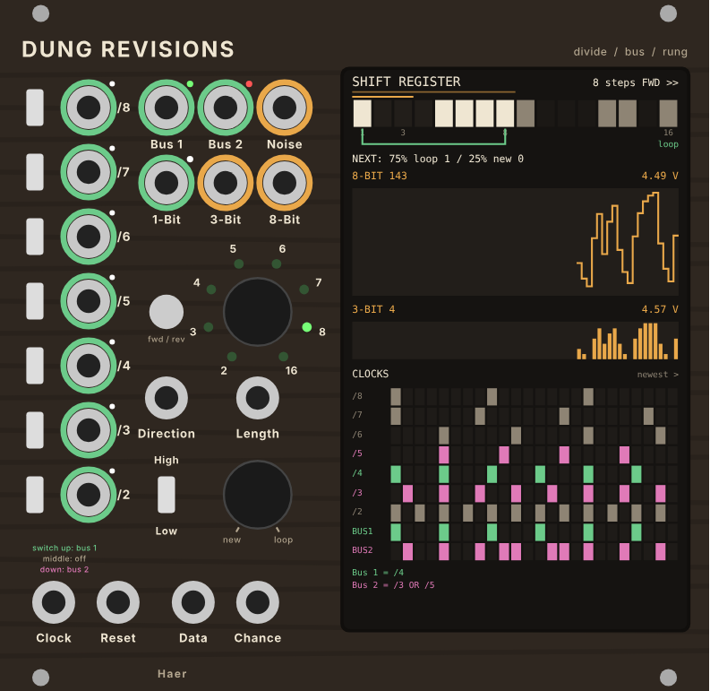

# Dung Revisions

A VCV Rack module by Haer: a clock divider with two OR buses feeding a
16-step shift register that can run in either direction (Rungler style),
with a display that shows what is going on inside.

- **/2 to /8** outputs, each with a 3-way switch: up sends it to Bus 1, the
  middle sends it nowhere, down sends it to Bus 2.
- **Bus 1 and Bus 2** OR together whatever is sent to them. Bus 1 also clocks
  the shift register.
- **Length** (2, 3, 4, 5, 6, 7, 8 or 16 steps) sets the loop point. The
  Length jack adds 1 V per position.
- **Chance**: clockwise, the bit at the loop point comes back and the pattern
  locks. Anticlockwise, Data XOR the loop-point bit goes in. In between, a
  weighted coin toss picks one or the other at each step.
- **Write**: High writes a 1 at the next step, Low writes a 0. By default the
  switch springs back to the middle after one step.
- **Direction** button and jack reverse the register.
- **Outputs**: 1-Bit (stage 1 as a gate), 3-Bit (stages 1-3, 8 levels),
  8-Bit (stages 1-8, 256 levels), and white noise.

Hover over any jack to see what it is doing right now. The right-click menu
has Clear register, Random fill, output ranges (including semitone steps on
the 3-Bit output), bit order, gate level and a few behaviour options.

## Install (Apple Silicon Mac)

Download `DungRevisions-2.0.0-mac-arm64.vcvplugin` from the
[latest release](../../releases/tag/latest) and drop it into
`~/Library/Application Support/Rack2/plugins-mac-arm64/`, then restart Rack.

## Build

GitHub Actions builds the plugin on every push to `main`. Locally:

    make dist RACK_DIR=/path/to/Rack-SDK

Engine tests (no Rack needed):

    c++ -std=c++11 -O2 -o test/engine_test test/engine_test.cpp && test/engine_test

The panel is drawn by `res/make_panel.py` (needs `pip install fonttools`).
